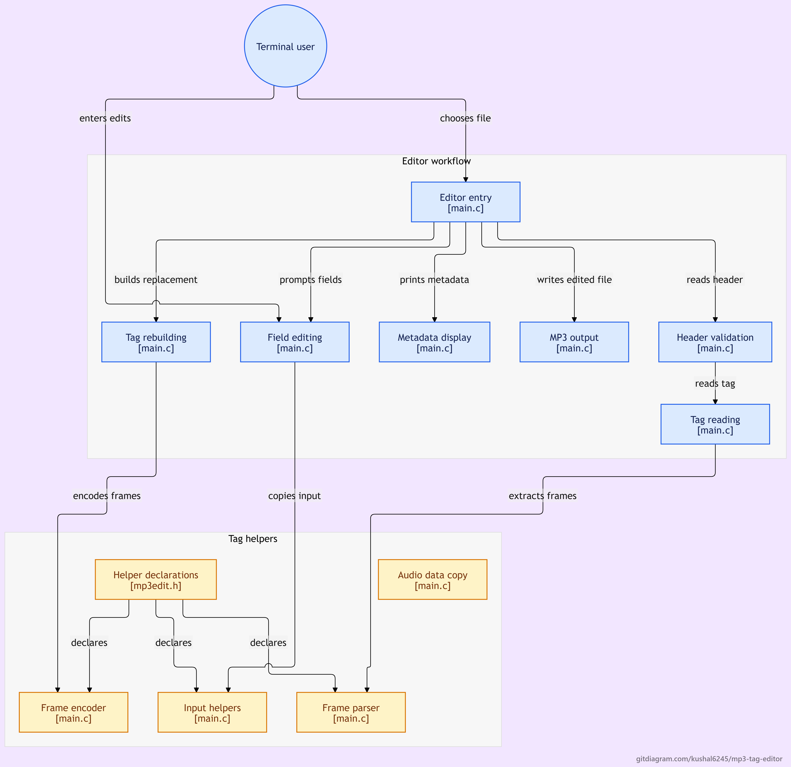

# MP3 Tag Editor

A terminal-based MP3 Tag Editor developed in C.

The project allows users to read, display, and modify metadata stored in MP3 files using ID3 tags.

## Features

- Read ID3 tags from MP3 files
- Read and validate the ID3 header
- Parse ID3 metadata frames
- Display existing metadata
- Edit song title
- Edit artist
- Edit album
- Edit year
- Edit genre
- Process MP3 files using binary file handling
- Save modified metadata to an output MP3 file

## Program Flow

The following diagram illustrates the flow of the MP3 Tag Editor program.



## Project Structure

```text
MP3-Tag-Editor/
│
├── main.c
├── mp3edit.h
├── sample.mp3
└── README.md
```

## Compilation

Compile the C source file using GCC:

```bash
gcc -Wall -Wextra -std=c11 main.c -o mp3editor
```

## Run

Run the program:

```bash
./mp3editor
```

Follow the on-screen instructions to read or edit MP3 metadata.

## How to Use

1. Compile the source code using GCC.
2. Run the MP3 Tag Editor.
3. Select the required operation from the menu.
4. Open or select an MP3 file.
5. View the existing metadata.
6. Modify the supported metadata fields.
7. Save the updated metadata.
8. Verify the output MP3 file.

*The exact steps depend on the operations implemented in the program.*

## Metadata Fields

The editor is intended to work with commonly used MP3 metadata fields, including:

- Title
- Artist
- Album
- Year
- Genre

## Concepts Practiced

This project was developed to practice:

- C Programming
- Structures
- Arrays
- Pointers
- Functions
- File Handling
- Binary File Handling
- String Handling
- Memory Management
- Metadata Parsing
- File Modification
- Modular Programming

## Requirements

- GCC Compiler
- Linux / WSL / Unix-like environment
- MP3 file for testing
- Visual Studio Code (optional)

## Learning

This project helps develop an understanding of how metadata is stored inside MP3 files and how binary file processing can be used to read and modify audio metadata using C.

## Author

**Kushal M**

Electronics and Communication Engineering

**Interests:** Embedded Systems, C Programming, and Firmware Development